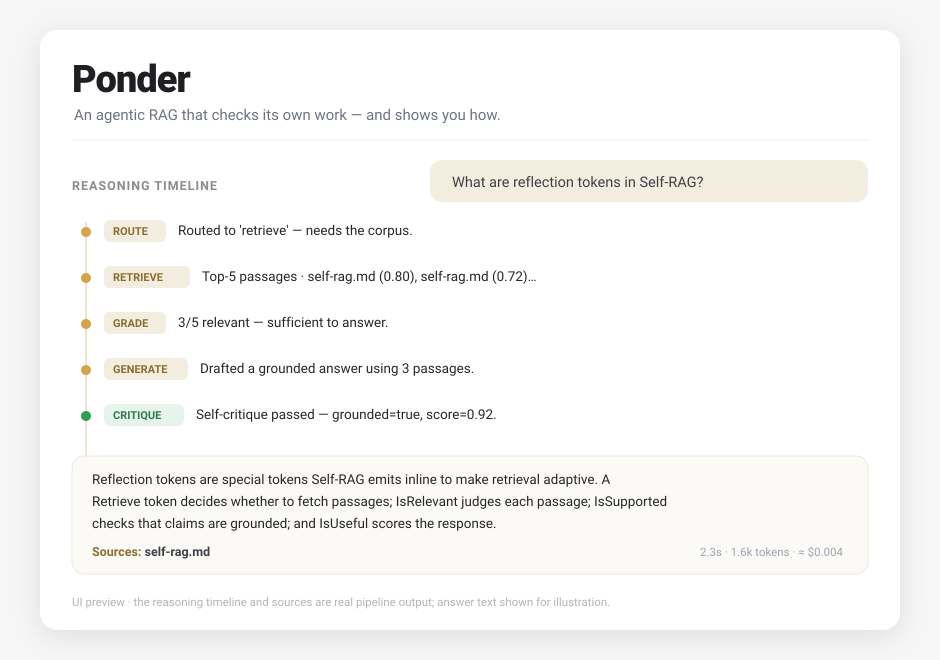
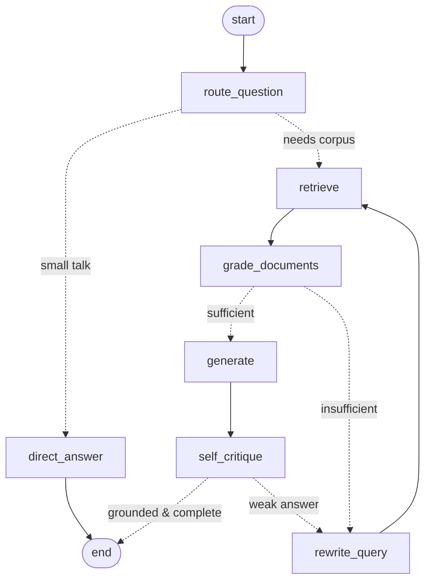
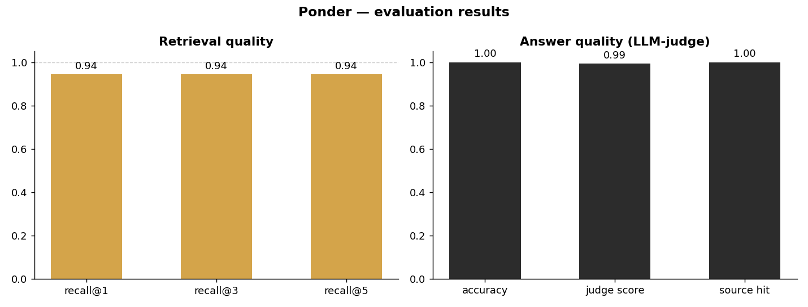

# Ponder

**An agentic RAG that checks its own work — and shows you how.**

Ponder answers questions from your documents, but unlike a plain RAG it does not
blindly trust its first search. It grades what it retrieves, rewrites its own
query when the evidence is weak, cites its sources, and critiques its own answer
before giving it to you — showing every step as it goes.

### The problem

A classic RAG makes a **single** retrieval pass and then answers from whatever it
found. If the search was bad, it has no way to notice — so it produces a fluent,
confident, and *wrong* answer.

### What Ponder does

- **Routes** the question (corpus lookup vs. small talk).
- **Retrieves** the top-k passages with local embeddings.
- **Grades** whether those passages are actually relevant and *sufficient*.
- **Rewrites the query and searches again** when the evidence falls short.
- **Answers with inline citations**, grounded only in the retrieved passages.
- **Self-critiques** the answer for groundedness and completeness — and loops back
  for another corrective pass if it's weak.

<p align="center">
  
</p>

> The live app streams the answer token-by-token and reveals each reasoning step
> in real time. *(To capture your own GIF, run the app with your key — see
> [Run it yourself](#run-it-yourself).)*

### Why it matters

Reliable, **sourced** answers over *any* corpus — internal docs, a knowledge base,
research — which is the #1 enterprise use case for LLMs. By verifying its own
retrieval and answer, Ponder catches the failure mode that makes naive RAG unsafe.

---

## Architecture

Ponder is a [LangGraph](https://langchain-ai.github.io/langgraph/) state machine
with two **bounded feedback loops**: a *corrective retrieval* loop driven by the
document grader, and a *self-correction* loop driven by the answer critic.



| Layer        | Choice                                              | Why                                  |
|--------------|-----------------------------------------------------|--------------------------------------|
| Agent loop   | LangGraph                                            | explicit, inspectable, loopable flow |
| Embeddings   | `BAAI/bge-small-en-v1.5` (sentence-transformers)    | **local, free, no API key**          |
| Vector store | Chroma (persistent, on disk)                        | runs out of the box, no server       |
| LLM          | Anthropic Claude (primary) · OpenAI (auto-fallback) | bring your **own** key               |
| UI           | Streamlit                                           | live timeline + streaming chat       |

**Retrieval needs no key** (embeddings are local). Only the reasoning/answer
steps call an LLM, using the key *you* provide.

---

## Run it yourself

You need **your own** LLM API key — the project never ships one. Retrieval and the
retrieval-only evaluation work without any key.

```bash
# 1. Clone
git clone https://github.com/alexandremourin/ponder.git
cd ponder

# 2. Install (creates .venv and installs deps)
make install          # or: python3.11 -m venv .venv && .venv/bin/pip install -r requirements.txt

# 3. Add YOUR key
cp .env.example .env
#   then edit .env and set ANTHROPIC_API_KEY=sk-ant-...   (OPENAI_API_KEY also works)

# 4. Build the index from data/corpus (~40 docs ship with the repo)
make ingest

# 5. Launch the chat UI
make run              # opens http://localhost:8501
```

If no key is found, the UI shows a clear message telling you to add one to `.env`.

### Use your own documents

Drop `.md` / `.txt` files into `data/corpus/` (or point `PONDER_CORPUS_DIR` at any
folder in `.env`), then re-run `make ingest`. That's it — the agent works over
your corpus.

### Evaluate

```bash
make eval-retrieval   # recall@k, MRR, latency — NO key needed
make eval             # adds end-to-end accuracy (LLM-as-judge), latency & cost — needs your key
make test             # run the test suite
```

---

## Results

Measured on the bundled 18-question eval set (`data/eval.jsonl`) over the 40-doc
corpus, with `BAAI/bge-small-en-v1.5` embeddings on CPU.

<p align="center"></p>

**Retrieval (measured, no API key):**

| Metric              | Value      |
|---------------------|------------|
| recall@1            | **0.94**   |
| recall@3            | **0.94**   |
| recall@5            | **0.94**   |
| MRR                 | **0.94**   |
| Retrieval latency   | ~22 ms / query (p95 ~37 ms) |

17 of 18 gold passages are retrieved at rank 1. The single miss (a chunking
question) lands at rank 6 with vanilla top-5 retrieval — exactly the case
Ponder's corrective rewrite loop is designed to recover.

**Answer quality (end-to-end):** `eval.py` also reports **accuracy** (LLM-as-judge
against reference answers), **mean judge score**, **latency**, and **cost per
query** (computed from real token usage). These require an LLM call per question,
so run `make eval` with your own key to reproduce them; results are written to
`assets/eval_results.json` and folded into the chart above.

---

## How it works (the code)

```
ponder/
  config.py        # all settings (env-overridable) + pricing for cost estimates
  embeddings.py    # local BGE embeddings (query-prefix handled correctly)
  chunking.py      # sentence-aware chunking with overlap
  vectorstore.py   # Chroma wrapper, cosine similarity 0..1
  ingest.py        # corpus -> chunks -> embeddings -> Chroma
  llm.py           # provider factory (Anthropic/OpenAI) + token & cost tracking
  pipeline.py      # ask() (blocking) and stream() (UI events)
  graph/
    state.py       # typed LangGraph state with a reducer-backed trace
    schemas.py     # structured-output models for router/grader/critic
    prompts.py     # one focused system prompt per node
    nodes.py       # route / retrieve / grade / rewrite / generate / critique
    build.py       # graph topology + the two feedback loops
app.py             # Streamlit UI (live timeline + streaming answer)
eval.py            # retrieval + answer-quality evaluation, charts
data/corpus/       # ~40 original documents on LLM agents, RAG, and MCP
data/eval.jsonl    # 18 reference Q/A pairs with gold sources
tests/             # chunking, retrieval, and graph-routing tests
```

---

## Credits & what's different from the original

Ponder started from
[**GiovanniPasq/agentic-rag-for-dummies**](https://github.com/GiovanniPasq/agentic-rag-for-dummies)
(MIT) — cloned, run, and studied — then rebuilt. The transformations:

1. **New corpus** — ~40 original documents on LLM agents, RAG variants, and the
   Model Context Protocol, so the repo works out of the box.
2. **An evaluation layer the original lacks** — `data/eval.jsonl` + `eval.py`
   measure recall@k, LLM-as-judge accuracy, latency, and cost/query, with a PNG
   chart in this README.
3. **Improved agentic logic — explicit, feedback-driven correction.** The original
   rewrites the query *once* up front and relies on a tool-calling orchestrator
   with token-budget compaction; it never grades the relevance of retrieved chunks
   and never critiques the final answer. Ponder adds (a) a **document-relevance
   grader** that gates generation, (b) a **corrective query-rewrite loop** that
   uses the grader's "what's missing" note to target the gap (CRAG-style) instead
   of a single blind upfront rewrite, and (c) a **self-critique node** that checks
   the answer's groundedness and completeness and can trigger another corrective
   cycle (Self-RAG-style). Both loops are explicitly bounded
   (`MAX_REWRITES`, `MAX_CRITIQUE_RETRIES`) so they always terminate.
4. **Streamlit UI** with a real-time reasoning timeline, in place of the original
   Gradio app.

## License

[MIT](LICENSE) © 2026 Alexandre Mourin.

*Educational project. Inspired by agentic-rag-for-dummies; corpus, evaluation
layer, agent logic, and UI are original work.*
